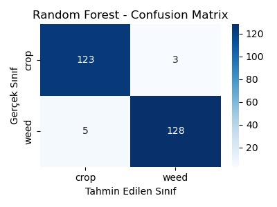
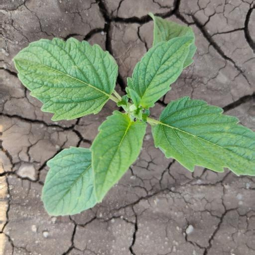
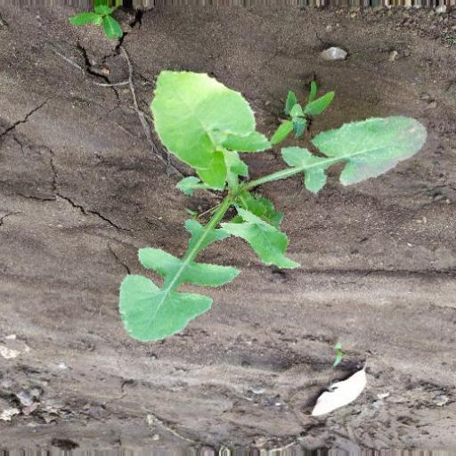

# Crop–Weed Classification using Classical Image Processing and Machine Learning

This project focuses on classifying crop and weed images using classical image processing and traditional machine learning techniques.

## Overview
The goal of this study is to distinguish crops from weeds in agricultural images by extracting hand-crafted features and applying classical classifiers.

No deep learning methods are used in this project.

## Feature Extraction
The following features are extracted from each image:
- Color features in HSV color space  
- Contour-based features  
- Texture features using GLCM  
- Edge and gradient features using HOG  

## Models
The following machine learning models are evaluated:
- Random Forest  
- Support Vector Machine (RBF kernel)  
- Logistic Regression  
- Gradient Boosting  

## Evaluation
- Train/Test split is used  
- 5-fold cross-validation is applied for Random Forest  
- Confusion matrices are visualized  
- Misclassified samples are saved for further inspection  

The Random Forest classifier achieved the best performance with an accuracy of approximately 97% (96.91%) on the held-out test set.

### Reproducibility & Deterministic Loading
Image files are enumerated in deterministic alphabetical order (`sorted(os.listdir(...))`) during feature extraction to eliminate operating system-dependent directory traversal differences (e.g., Windows NTFS vs. Linux ext4 inode ordering). The official academic benchmark metrics reported in the study (BM331) are produced using this deterministic pipeline:
- **Test Accuracy:** 96.91%
- **5-Fold Cross-Validation:** 96.64% (Fold accuracies: `[0.9569, 0.9712, 0.9567, 0.9712, 0.9760]`)
- **Out-of-Bag (OOB) Estimate:** 97.21%
- **Training Set Accuracy:** 99.81%

## Visualization
The following visualizations provide insights into model performance and common misclassification cases.

### Confusion Matrix (Random Forest)


### Misclassified Samples

**Weed classified as Crop**  


**Crop classified as Weed**  


## Dataset
The dataset is expected to have the following structure:

```
dataset_final/
├── train/
│   ├── crop/
│   └── weed/
└── test/
    ├── crop/
    └── weed/
```

The dataset path can be specified using the `DATASET_PATH` environment variable.

## Output
Misclassified samples from the Random Forest model are saved in the `misclassified_examples/` directory.

## How to Run

```bash
python classification.py
```

Make sure the dataset path is correctly set before running the script.
If the dataset is not located in the project directory, set the path using the `DATASET_PATH` environment variable.
